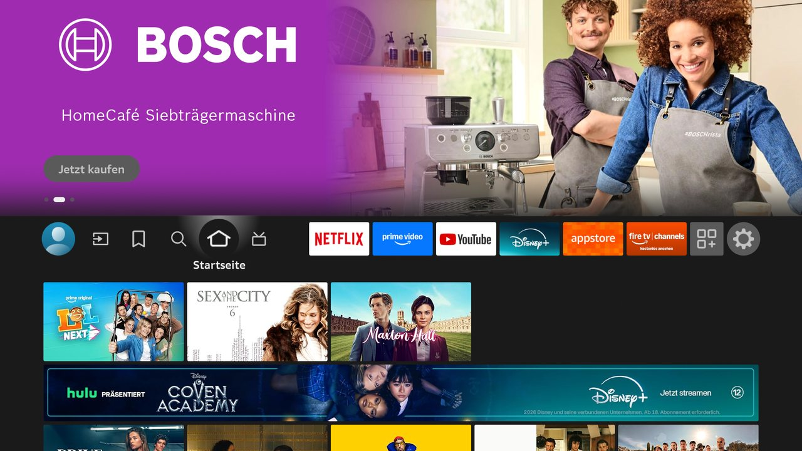
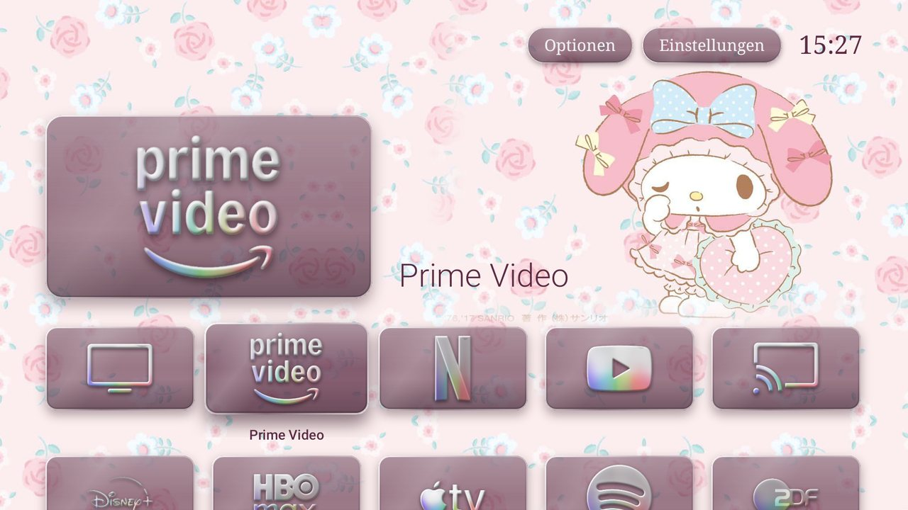
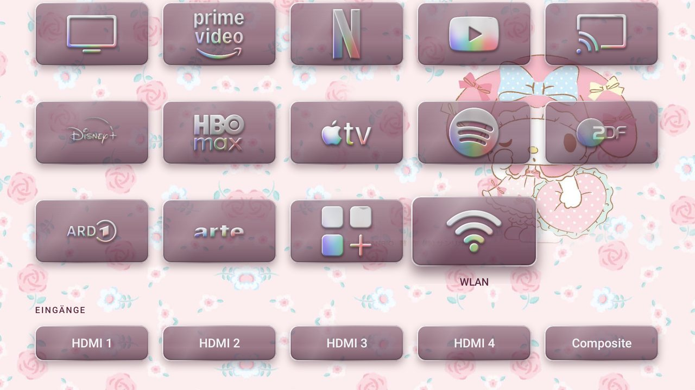
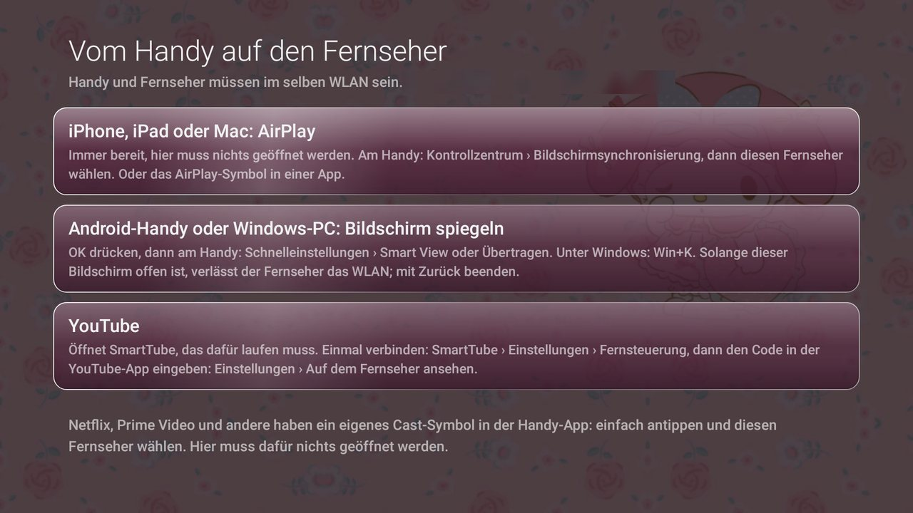

# hello-kitty-tv

A second-hand Amazon Fire TV 4-Series with the ads and tracking taken out, and a new home screen
in the style of iOS 26's clear glass, set up over ADB with no root. It is built on
[dumbtv](https://github.com/humblemuzzu/dumbtv), with fixes and features this TV needed.

| Before | After |
|---|---|
|  |  |

| Every tile | Casting from a phone |
|---|---|
|  |  |

## The TV

| | |
|---|---|
| Model | Amazon Fire TV 4-Series, 55 inch, 4K |
| Retail model | 4K55N400D (`AMZ_4K55N400D` on the About screen) |
| ADB model | `AFTKAUK001`, codename `anna` |
| Chip | MediaTek `m7632`: four Cortex-A55 cores at 1.5 GHz, 32-bit apps |
| Memory | 1.7 GB RAM visible to Android, 11 GB of storage |
| Software | Fire OS 7.7.1.7, build PS7717.5741N, Android 9 (SDK 28), March 2026 patch level |
| Picture | 4K panel, with the interface drawn at 1080p |

The notes for dumbtv's catalog are in
[`catalog/devices/fireos-amazon-aftkauk001.yaml`](catalog/devices/fireos-amazon-aftkauk001.yaml).

## What it does

**Home screen**
- A top shelf modelled on the Apple TV: the focused app large, over a wallpaper you can see through
  the tiles.
- Glass tiles with a shadow, inner light, a bright rim and a sheen. They are drawn once into bitmaps,
  so they stay smooth on this slow chip.
- Every logo cut out of its background and given the pearly look of the Apple TV logo.
- A serif clock, Options and Settings, in [Tinos](https://github.com/googlefonts/tinos), which is
  drawn to Times New Roman's measures.
- Tiles Fire OS does not offer: **cable TV**, **casting**, and **Wi-Fi settings** in one press.
- A screensaver that shows one picture of your choice and nothing else.

**Privacy and ads**
- 44 packages off, including those that hold screen-capture permissions (`hedwig`, `logan`,
  `ods.kindleconnect`) and the viewing recognition service (`tv.acr`).
- A DNS filter on the TV with about 78,000 blocked names: Amazon's trackers and update servers,
  general ad and tracker lists, and telemetry read off this TV's own DNS log. An allow list keeps the
  streaming apps and Alexa's voice servers reachable.
- Ad tracking and usage reporting switched off.
- YouTube through [SmartTube](https://github.com/yuliskov/SmartTube), which has no ad code, with
  Shorts hidden and sponsored segments skipped. Its tile uses the usual YouTube logo.

**Security**
- ADB debugging is off when the work is done, so port 5555 is closed.
- Installing from unknown sources is off, and SmartTube cannot install its own updates.
- AirPlay asks new devices for a code. Alexa and casting keep their ports open, because they are in use.

## Results

Measured with `scripts/benchmark.sh` on this TV, over weak Wi-Fi.

| | Stock | Final |
|---|---|---|
| Home screen, janky frames | 34% | 0% in three runs, 10% in one right after a heavy app test |
| Home screen, 90th percentile frame | 27 ms | 6 to 17 ms |
| Home screen, 99th percentile frame | 85 ms | 12 to 25 ms |
| Home screen app's memory | 201 MB | 104 to 131 MB |
| Swap in use, 3 minutes after boot | 218 MB | 130 MB |
| Packages switched off | 2 | 44 |
| RAM available, 3 minutes after boot | 498 MB | 453 MB |
| Boot to ready | 73 s | 95 s |
| Opening most apps | 0.7 to 1 s | about the same |

So the home screen is far smoother and the TV leans less on swap, but free RAM and boot time did not
improve: the filter and the richer home screen use what the cleanup freed. Apps mostly open as fast as
before. Compiling ahead of time helped some (ZDF opened in half the time) and slowed others (Prime
Video, Disney+ and HBO Max), so `scripts/speed.sh` only does it where it helped.

## What it cannot do

- **Restyle the inside of apps.** Netflix, Prime Video and Fire OS's settings draw their own screens.
- **Block ads inside streams.** They usually come from the same servers as the video. Prime Video
  needs its paid ad-free add-on, and Netflix, Disney+ and HBO Max only show ads on their ad plans.
- **Delete Amazon's software.** Without root it can only be switched off. A few packages refuse even
  that, so they are restricted and their servers blocked. Each streaming service still knows what you
  watch on it.
- **Keep Fire OS updated.** The filter blocks updates, because one would switch much of this back on,
  and that also stops security patches. See [the FAQ](docs/FAQ.md) for updating on purpose.

**Not tested end to end:** the checks ran over ADB. They confirm that all apps open, the tuner starts
and AirPlay answers on the network, but not video playback, the voice button or casting from a real
phone. Those need a person at the TV.

## Doing the same

You need `adb`, Git Bash or a Unix shell, and a JDK 17 with the Android SDK to build the launcher
(`platforms;android-25`, `build-tools;34.0.0`). Turn on ADB debugging on the TV first.

```sh
git clone https://github.com/franzglaeser03-cmd/hello-kitty-tv && cd hello-kitty-tv
adb connect <tv-ip>:5555        # press Allow on the TV and tick Always allow
./scripts/preflight.sh          # read-only: check the router it prints is really yours

./scripts/configure.sh -y --prime 1 --alexa 1 --launcher 1 --dnsfilter 1 --youtube 1 --adblock light
printf 'FILTER_AUTOSTART=0\nLAUNCHER_BUILD=1\n' >> dumbtv.conf

./scripts/debloat.sh -y
./scripts/lockdown.sh -y
./scripts/dnsfilter.sh -y
./scripts/launcher.sh -y        # builds the launcher from this checkout
./scripts/youtube.sh -y
./scripts/verify.sh             # must end with: all checks passed
```

Then, on a TV you can reach by hand:

```sh
# Packages this TV could do without, with automatic rollback if a check fails.
# Leave out anything you use.
./scripts/trial.sh com.amazon.tahoe com.amazon.bueller.photos com.amazon.ods.kindleconnect \
  com.amazon.kso.blackbird com.amazon.audiolatencymeasurer
./scripts/speed.sh --compile

# The look. Wallpapers come from launcher/wallpapers.py or your own picture.
FILES=/sdcard/Android/data/tv.dumbtv.home/files
python3 launcher/wallpapers.py wallpapers
adb shell mkdir -p $FILES/wallpapers $FILES/icons
adb push wallpapers/. $FILES/wallpapers/
python3 tools/fetch-icons.py icons-src      # needs Pillow and numpy for the next line
python3 tools/glass-icons.py icons-src icons
adb push icons/. $FILES/icons/
adb push examples/home.conf $FILES/home.conf

# One picture as the screensaver.
adb push my-picture.jpg $FILES/screensaver.jpg
adb shell settings put secure screensaver_components tv.dumbtv.home/.Dream
adb shell settings put secure screensaver_default_component tv.dumbtv.home/.Dream
adb shell settings put secure contextual_screen_off_timeout 300000

# Lock it down, last of all: this ends your adb session.
adb shell settings put secure install_non_market_apps 0
adb shell appops set org.smarttube.stable REQUEST_INSTALL_PACKAGES deny
adb shell settings put global adb_enabled 0
```

`examples/home.conf` uses `glass_tone=smoked`, which suits a light picture. Use `clear` with the dark
wallpapers from `launcher/wallpapers.py`. More in [the launcher's README](launcher/README.md).

**Undo:** turn ADB back on, then run `./scripts/restore.sh`. A factory reset also removes everything,
because nothing here touches `/system`.

## What this TV taught us

- **A wired port can hide the real router.** This TV's cable went to a range extender that had not
  joined the Wi-Fi. Android keeps a default route for that dead network too, and dumbtv took it for the
  router, which would have cut the internet for every app. `gateway()` now asks which route the
  internet really takes.
- **A static IP will not fix that cable.** Nothing behind the extender reaches the router until it is
  paired. Until then, unplug the cable: an unpaired extender tends to offer an open Wi-Fi network, and
  anyone who joins it can reach the TV's open ports.
- **The DNS filter can lose a race at boot.** On some boots its tunnel came up with DNS going around
  it, so nothing was blocked. `FILTER_AUTOSTART=0` held across every reboot tested. Run `verify.sh`
  after a reboot, not just after the install.
- **Screen mirroring takes the Wi-Fi radio.** Opening Fire OS's receiver drops the TV off Wi-Fi until
  that screen closes, so do not open it over ADB on a TV you cannot reach by hand.
- **AirPlay is already there.** Apple's own AirPlay app ships on this TV and answers on the network,
  with no third-party receiver needed.
- **App Store icons can already be iOS 26 renders.** Several come with the glass rim built in.

## What is different from dumbtv

The original README is kept as [DUMBTV-README.md](DUMBTV-README.md), and its docs and rules still apply.
New here:

- Launcher: `Glass.java`, `Cast.java`, `Dream.java`, the top shelf layout, the three new tiles.
- Scripts: `benchmark.sh`, `audit.sh`, `trial.sh` and `speed.sh`; `configure.sh --adblock`; router
  detection; transfers that survive weak Wi-Fi; a launcher build that works from Git Bash.
- `tools/` for the icons, `launcher/wallpapers.py`, `examples/home.conf`.

## Credits and licences

- [dumbtv](https://github.com/humblemuzzu/dumbtv) by Muzzammil and its contributors: this project is
  their work with additions. MIT for scripts, docs and the launcher, CC BY-SA 4.0 for the device
  catalog, as in [LICENSE](LICENSE) and [catalog/LICENSE](catalog/LICENSE).
- The top shelf follows the idea in [dumbtv PR #21](https://github.com/humblemuzzu/dumbtv/pull/21) by
  jonathanrzarzuela-cloud.
- [personalDNSfilter](https://github.com/IngoZenz/personaldnsfilter),
  [HaGeZi's DNS blocklists](https://github.com/hagezi/dns-blocklists) and
  [SmartTube](https://github.com/yuliskov/SmartTube) are downloaded when you ask for them.
- [Tinos](https://github.com/googlefonts/tinos), SIL Open Font License, in `launcher/assets/fonts/`.
- Built with [Claude Code](https://claude.com/claude-code).

Not affiliated with or endorsed by Amazon, Apple, Sanrio or any streaming service. Hello Kitty and My
Melody are trademarks of Sanrio, and the art in the screenshots is © Sanrio. App logos belong to their
owners. None of those pictures are in this repository as files, only as they appear in the screenshots:
bring your own picture, and fetch icons for your own TV.

Use at your own risk. Changing a TV like this is your call and your responsibility.
